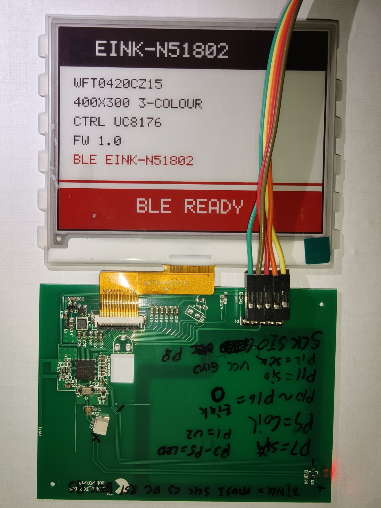
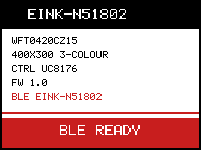

# eink-n51802 — nRF51802 + WFT0420CZ15 (4.2″ 400×300 黑白红) 固件



## 板子基本信息

- **控制板**：绿色 PCB，与电子纸通过 FPC 排线连接
- **主控**：nRF51802（Cortex-M0，256 KB Flash / 16 KB RAM）；开发连接使用 RP2040 debugprobe 的 SWD/UART
- **无线**：BLE（S110 8.0.0）
- **驱动 IC**：UC8176（WFT0420CZ15 有 UC8176 / UC8179 两代，这块板是 UC8176）
- **引脚（nRF51802 P0）**：
  - P10：DIN/回读、P11：CLK、P12：CS、P13：DC、P14：RST、P16：BS1（活动中拉低，空闲拉高）
  - P3 / P4 / P5：LED，低电平点亮
  - P8：UART0 TX（57600 8N1）
  - P9：感应线圈 RF 唤醒输入 — P9 经耦合电容接线圈，线圈另一端接地，P9 有 150 kΩ 下拉；固件配置为系统关机 sense-high 唤醒（不接收 NFC 协议数据）
- **时钟**：16 MHz 晶振，nRF51 无 PLL，CPU 运行在 16 MHz
- **供电**：照片中面板与控制板已接 3.3V（以实际电源接线为准）

> **上电与唤醒行为**：断电再上电会从复位向量重新启动，不是深睡状态。每次启动都会重画内置信息页（约 30 s）。BLE 空闲 30 s 后进入系统关机，P9 配置为 sense-high 唤醒输入；靠近 NFC/感应场且 P9 正向脉冲超过输入阈值时，MCU 重新启动。P9 只能感应场强，不能读取 NFC 协议/App 数据。

自制固件，替换板子原厂固件。已在本机实机上完整验证：

- 开机 → 屏幕刷新**内置信息页**（约 30 s）→ 面板进深睡
- BLE 广播 `EINK-N51802`，可通过自定义 GATT 服务**上传新画面**（实测通过）



## 硬件事实（全部来自逆向原厂固件 + 实测）

| 项 | 值 |
|---|---|
| 面板控制器 | **UC8176**（WFT0420CZ15 有 UC8176/UC8179 两代，这块是老的） |
| 面板引脚 | P10=DIN/回读、P11=CLK、P12=CS、P13=DC、P14=RST、P16=BS1（活动中拉低/空闲拉高）、P15 未用 |
| LED | P3/P4/P5，低电平点亮 |
| 调试串口 | P8 → RP2040 debugprobe RX，**57600 8N1**（硬件 UART0） |
| P9 | 感应线圈耦合输入 | P9 经 耦合电容接线圈，线圈另一端接地，P9 有 150 kΩ 下拉；系统关机时用 GPIO sense-high 唤醒；nRF51 无 NFC 硬件，不接收 NFC 协议数据 |
| 时钟 | 16 MHz 晶振；nRF51 **无 PLL**，内核就是 16 MHz |
| 时间基准 | RTC1（LFCLK 32768 Hz）；S110 占用 TIMER0/RTC0，TIMER1/2 在 SD 下不正常 |

### 关于硬件 UART 的一个坑（已修复）

早期判定“硬件 UART 不工作”是本项目的错误：nRF51 的 UART `ENABLE` 字段在 bit[2:0]，**启用值是 `4` 而不是 `1`**；
57600 的波特率编码是 `0x00EBF000`（nRF52 的 `0x00B00000` 在 nRF51 上不存在）。改对后硬件 UART 正常工作，
并且 SoftDevice 运行时也不会被射频中断打断（软件模拟 UART 会乱码）。

## 构建

需要 xPack ARM 工具链（`C:\xpack-arm-none-eabi-gcc-15.2.1-1.1\bin`）：

```powershell
python build.py          # 生成 bin/eink_n51802_full.bin（S110 @0x0 + app @0x18000）
python build_minimal.py  # 独立最小测试镜像 @0x0（不依赖 SoftDevice）
```

## 烧录（RP2040 debugprobe + pyOCD）

```powershell
python -m pyocd load -t nrf51 -f 1000000 -e chip 'bin/eink_n51802_full.bin@0x0'
```

## BLE 传图

服务 `0xFFF0`，写入特征 `0xFFF1`（write / write-without-response，单包 ≤ 20 字节）。
每包第 1 字节是操作码：

| 操作码 | 含义 |
|---|---|
| `0x01` | 开始：面板复位+初始化，打开黑白平面（`0x10`） |
| `0x02` | 后跟 ≤19 字节图像数据，直接写进当前平面 |
| `0x03` | 切到红色平面（`0x13`）；累计 15000 字节也会自动切换 |
| `0x04` | 结束：发刷新命令（`0x12`），约 20 s 后进深睡 |

平面编码：黑白平面 **bit 0 = 黑**；红色平面 **bit 0 = 红**（控制器收反相数据，即 1 = 无红）。
每平面 15000 字节（400×300 / 8）。

本机实测：

```powershell
python -m pip install bleak
python tools/ble_upload.py   # 生成测试图 → 扫描 → 连接 → 推 30 KB → 触发刷新
```

一次完整传图约 32 s（S110 的 ATT MTU 只有 23，每包 20 字节，一个连接间隔一包）。
刷新期间连接会被主动断开（面板刷新要 20 s，超出监督超时），刷新完成后设备重新广播。

## 目录

| 文件 | 说明 |
|---|---|
| `src/main.c` | 启动流程、BLE 广播/GATT、传图状态机 |
| `src/eink.c` / `eink.h` | UC8176/UC8179 驱动、5×7 字体、信息页、流式写平面 |
| `src/nrf51_min.h` | nRF51 寄存器定义（GPIO/UART/CLOCK/TIMER/RTC）与时间基准 |
| `src/hwuart.h` | 硬件 UART0 调试输出 |
| `src/swuart.h` | 软件模拟 UART（备用，SD 运行时不可用） |
| `src/startup.c` | 向量表、`.data/.bss` 初始化 |
| `firmware.ld` / `minimal.ld` | 应用 / 最小镜像链接脚本 |
| `tools/ble_upload.py` | BLE 传图客户端（Python + bleak） |
| `tools/preview_eink.py` | 在 PC 上渲染信息页（就是 `docs/boot_screen.png`），避免为排版错误白白刷屏 |
| `ghidra_scripts/DumpAll.java` | Ghidra 脚本：反编译全部函数到 `ghidra_dump.c` |
| `docs/REVERSE_ENGINEERING.md` | 逆向原厂固件的完整方法与函数表 |
| `sdk/s110/` | S110 v8.0.0 SoftDevice（Keil pack 提取） |

## 逆向记录

原厂固件（本机 dump，不随仓库分发）用 Ghidra 12.2 反编译，完整步骤见 `docs/REVERSE_ENGINEERING.md`。关键函数：

- `FUN_00000ac4` SPI 字节输出（MSB first、CLK 低时改数据）
- `FUN_00000afc` 命令（DC=0）/ `FUN_00000b1a` 数据（DC=1），CS 每字节翻转
- `FUN_00000c08` 复位（三段脉冲）+ `0x04` 上电 + `0x00 {0x0F,0x0D}`
- `FUN_000010ae` 刷屏：`0x10`+15000B → `0x13`+15000B → `0x12` → `0x50=F7` → `0x02` → `0x07=A5`
- `FUN_00000bcc` 忙等：发 `0x71` 后用 P10 回读，但把 `PIN_CNF[10]` 写成 0（输入缓冲断开），
  永远读到 0，所以实际上是**固定延时**，不是真正的忙信号

> 注意：Ghidra 12.2 需要 **JDK 25**（JDK 21 会被拒绝）。
