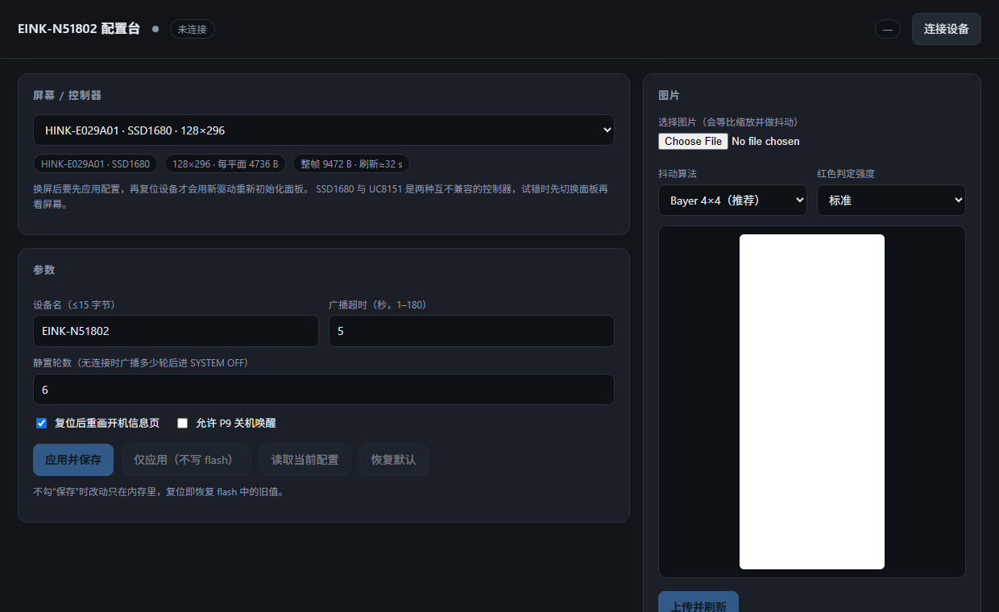
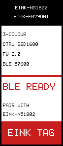
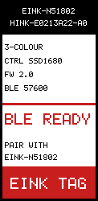
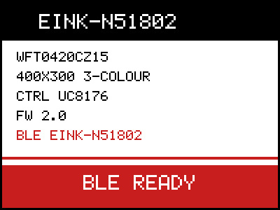

# eink-n51802 — nRF51802 多屏电子纸固件


同一份固件支持多块电子纸面板，面板在运行时通过 `panel=` 配置切换（见下文）。驱动按面板描述符
（`src/panel.h`）注册，新增屏幕只需加一条描述符 + 一个驱动文件。

当前的实机状态：**4.2″ WFT0420CZ15 全部功能早前已验证；2.9″ HINK-E029A01（SSD1680）已在本机实测通过**
（开机信息页 + BLE 传图，黑白红三色正确）。

## 网页配置

自带一个 Web Bluetooth 配置页，浏览器里连上标签就能读/改配置、传图，不用装 Python 依赖：

```powershell
python tools/serve_web.py        # 打开 http://127.0.0.1:8080
```

- 需要桌面版 **Chrome / Edge**；Web Bluetooth 只在安全上下文可用，`http://localhost` 算安全，
  所以本地起个静态服务就够，不用证书。手机浏览器用 `chrome://inspect` 之类的方式访问同一局域网地址则需要 https。
- 页面功能：读取当前配置（面板、名称、广播超时、静置轮数、开机重画、P9 唤醒）、切换面板、写 flash、
  传图片（Bayer 抖动 / 纯阈值，可调红色判定）、实时日志。
- 换屏流程：选面板 → **应用并保存** → 复位设备（`python -m pyocd reset -t nrf51 -f 1000000` 或断电重上电）
  才会用新驱动重新初始化面板。

配置特征 `0xFFF2` 是**可读**的，连接后返回 20 字节打包状态（网页就是靠它回显当前值的）：

| 偏移 | 长度 | 内容 |
|---|---|---|
| 0 | 4 | `"EINK"` |
| 4 | 1 | 配置结构版本（当前 6） |
| 5 | 1 | 面板索引 |
| 6 | 1 | 标志位：bit0 开机重画，bit1 P9 唤醒，bit2 面板休眠（保留） |
| 7 | 1 | 广播超时（秒） |
| 8 | 1 | 静置轮数 |
| 9 | 11 | 设备名（NUL 填充） |

> 每次写入配置后固件都会重新发布这个快照；否则栈里存的是刚才写入的命令文本。

收到 `0x01` 通知表示一次图片刷新已经结束：

```
0xFFF2  notify: 01        ← 面板刷新完成
```



## 板子基本信息

- **控制板**：绿色 PCB，与电子纸通过 FPC 排线连接
- **主控**：nRF51802（Cortex-M0，256 KB Flash / 16 KB RAM）；开发连接使用 RP2040 debugprobe 的 SWD/UART
- **无线**：BLE（S110 8.0.0）
- **引脚（nRF51802 P0）**：
  - P10：DIN、P11：CLK、P12：CS、P13：DC、P14：RST、P15：BUSY、P16：BS1
  - BS1 在访屏期间拉低（4 线 SPI），空闲拉高 —— 与原厂固件一致
  - P3 / P4 / P5：LED，低电平点亮
  - P8：UART0 TX（57600 8N1）
  - P9：感应线圈输入（运行时 + 关机两种模式）—— P9 经耦合电容接线圈，线圈另一端接地，P9 有 150 kΩ 下拉；原厂固件同样把它配成 `PIN_CNF = 0x00020000`（输入接通 + SENSE 高电平）。**当前默认不启用**：实测手机靠近只有约 0.5 V，而 nRF51 数字门限是 0.7×VDD ≈ 2.31 V，启用后会永久睡死。需要给线圈并联谐振电容或加检波/比较器后，用 `-DENABLE_P9_WAKE=1` 打开
- **时钟**：16 MHz 晶振，nRF51 无 PLL，CPU 运行在 16 MHz

## 支持的屏幕

| `panel=` | 面板 | 控制器 | 分辨率 | 状态 |
|---|---|---|---|---|
| 0 | WFT0420CZ15 | UC8176 | 400×300 黑白红 | 原始 4.2″ 屏，命令序列由原厂固件逆向得到，**已实机验证** |
| 1 | WFT0420CZ15 | UC8179 | 400×300 黑白红 | 4.2″ 新批次，Waveshare `epd4in2b_V2` 序列，未实测 |
| **2（默认）** | **HINK-E029A01** | **SSD1680** | **128×296 黑白红** | **已实机验证（本次）** |
| 3 | HINK-E029A01 | UC8151 | 128×296 黑白红 | 另一颗控制器，本机实测**不匹配**（BUSY 完全不动），保留备用 |
| 4 | HINK-E0213A22-A0 | SSD1680 | 122×250 黑白红 | 2.13″，几何与 2.9″ 同族但**不是 8 的倍数**（见下），尚未实机验证 |

HINK-E029A01 市面上 SSD1680 和 UC8151 两种控制器都有，初始化序列互不兼容，**两颗都编进固件**，
用 `panel=2` / `panel=3` 选择。

启动信息页（`tools/preview_eink.py` 在 PC 上渲染，避免排版错误白刷屏）：

| HINK-E029A01（128×296） | HINK-E0213A22-A0（122×250） | WFT0420CZ15（400×300） |
|---|---|---|
|  |  |  |

## 2.9″ HINK-E029A01 实测结论（2026-11-07）

这块屏的实际参数与坑，全部来自本机实测，不是抄文档：

**控制器是 SSD1680。** 判据是 BUSY：按 SSD1680 语义（高=忙）等待时，`0x22/0x20` 之后 BUSY 拉高
**9291 ms** 后释放；按 UC8151 语义（低=忙）等待时，整个刷新期间 BUSY 完全不动，只能靠固定延时兜底。
所以 `panel=2` 正确，`panel=3` 不匹配。

**红色平面极性是「1 = 红」。** 用 `EPD_DIAG=1 python build.py` 编出的四分带测试图直接问出来
（从上到下四带的黑平面位/红平面位 = 11 / 01 / 10 / 00）：

| 黑位 | 红位 | 实测颜色 |
|---|---|---|
| 1 | 1 | 红 |
| 0 | 1 | 红 |
| 1 | 0 | 白 |
| 0 | 0 | 黑 |

即：黑平面 **1 = 白、0 = 黑**（与常见驱动一致），红平面 **1 = 红**（与 Waveshare 新驱动相反）。
搞错这一位时屏幕上就是「只有红色、没有黑色」。面板描述符里的 `panel_t.red_one` 记录这一点，
4.2″ 屏是 0（1 = 无红），HINK 的 SSD1680 是 1（1 = 红）。BLE 客户端始终按逻辑位发（红平面 1 = 红），
固件在 `eink_stream_byte()` 里按面板反转。

**RAM 窗口：296 行 × 16 字节/行 = 4736 字节/平面。** `0x44` 写字节列 0..15，`0x45` 写行 0..295 ——
注意 `0x45` 是「起始低、起始高、结束低、结束高」，**先起始后结束**；本固件初版把这两对写反
（start=295、end=0），屏幕就是花屏。

**几何方向**：128 源极 × 296 栅极，画面是「竖版 128 宽 × 296 高」，与价签的竖装方向一致。

**刷新时长**：整屏三色更新 **30.7 s**（BUSY 高电平，多次可复现）。同一晚早些时候对同样内容曾测得
9.3 s，说明这块屏的波形时长不稳定（温度补偿 / OTP LUT 选择都可能影响），固件按最坏情况兜底：
`refresh_ms` = 32 s 固定延时，BUSY 等待上限 45 s，避免提前发深睡把波形截断。

## 2.13″ HINK-E0213A22-A0

122 源极 × 250 栅极，三色。两个要点：

- **122 不是 8 的倍数**：一个 RAM 行是 `ceil(122/8) = 16` 字节，末字节有 6 个位落在玻璃之外。
  固件用 `panel_row_bytes()` 计算行宽，超出面板宽度的列按白色输出，所以不会画到相邻像素上。
  一个平面 = 16 × 250 = **4000 字节**（整帧 8000）。
- 垂直排版按面板高度等比缩放（`YS(v) = v * H / 296`），250 行的屏上元素不会挤到页脚里。

驱动沿用 2.9″ 那套 SSD1680 序列（`0x01` 栅极数、`0x44` 字节列、`0x45` 行窗口都由描述符算出），
红平面极性沿用 2.9″ 实测的 **1 = 红**。**这块屏本身还没有上机验证**。

## 切换屏幕

BLE 写特征 `0xFFF2`：

```text
panel=4
save
```

`panel=` 只改内存，`save` 才落盘；不 `save` 的话下次复位回到默认值（2 = HINK-E029A01 + SSD1680）。
串口会打印当前面板与控制器：

```text
E-ink: HINK-E029A01 SSD1680 init
```

## 上电与唤醒行为

断电再上电会从复位向量重新启动，不是深睡状态。每次启动都会重画内置信息页（4.2″ 约 20 s，
2.9″ 约 36 s，**其中 30 s 是面板刷新**）。不想每次开机都刷屏可以用 `boot=0`。
BLE 空闲 30 s 后进入系统关机，P9 配置为 sense-high 唤醒输入；靠近 NFC/感应场且 P9 正向脉冲超过输入阈值时，
MCU 重新启动。P9 只能感应场强，不能读取 NFC 协议/App 数据。

## 硬件事实

| 项 | 值 |
|---|---|
| 面板引脚 | P10=DIN、P11=CLK、P12=CS、P13=DC、P14=RST、P15=BUSY、P16=BS1 |
| LED | P3/P4/P5，低电平点亮 |
| 调试串口 | P8 → RP2040 debugprobe RX，**57600 8N1**（硬件 UART0） |
| P9 | 感应线圈耦合输入；系统关机时用 GPIO sense-high 唤醒；nRF51 无 NFC 硬件，不接收 NFC 协议数据 |
| 时钟 | 16 MHz 晶振；nRF51 **无 PLL**，内核就是 16 MHz |
| 时间基准 | RTC1（LFCLK 32768 Hz）；S110 占用 TIMER0/RTC0，TIMER1/2 在 SD 下不正常 |

### BUSY 怎么用

原厂固件从不读 P15，4.2″ 面板的 BUSY 也没接到板子上。**2.9″ 这块是接了的**：刷新期间 BUSY 拉高、
结束后释放，实测 9.29 s。固件因此做成「先探测、再兜底」：`epd_wait_busy()` 采样 300 ms，引脚完全不动
就判定未连接，交给各面板描述符里的 `refresh_ms` 固定延时。串口日志里的 `busy_used=` 表示这次是否真的
读到了忙信号，`release_ms=` 是实测的忙时长。

### 一个没解释清的坑：广播数据必须放 flash

`sd_ble_gap_adv_data_set()` 如果传的是**位于 `.data` 的非常量**数组，S110 会卡死在 SVC 里
（PC 停在 SoftDevice 的 SVC 分发器，`xpsr` 的 IPSR=11，串口再无输出）。把同一个数组改成
`static const`（放 flash）就正常，扫描响应仍在 `.bss`、照常工作。`.data` 段的拷贝本身已验证正确
（boot 时打点校验过），所以这不是链接脚本问题。**结论：广播数据保持 `const`**，面板信息不要再塞进
广播包（用设备名/串口即可）。

## 构建

需要 xPack ARM 工具链（`C:\xpack-arm-none-eabi-gcc-15.2.1-1.1\bin`）：

```powershell
python build.py            # bin/eink_n51802_full.bin（S110 @0x0 + app @0x18000）
EPD_DIAG=1 python build.py # 四分带诊断镜像：用来询问面板的黑/红位组合映射
python build_minimal.py    # 独立最小测试镜像 @0x0（不依赖 SoftDevice）
```

所有面板驱动都编进同一个镜像，不需要按屏幕分别编译。

## 烧录（RP2040 debugprobe + pyOCD）

```powershell
# 首次烧录（含 S110）：整片 256 KB
python -m pyocd load -t nrf51 -f 1000000 -e chip 'bin/eink_n51802_full.bin@0x0'

# 之后只更新应用：保留 flash 配置页
python -m pyocd load -t nrf51 -f 1000000 'bin/eink_n51802_app.bin@0x18000'

python tools/capture_uart.py 20 57600 COM16 --reset   # 复位并抓串口日志
```

> 为什么要分两种：300 KB 的整片镜像里除 S110 和应用外全是 `0xFF`，而配置页在 `0x3FC00`
> （镜像范围内），整片烧写会把它一起写掉、配置回到默认值。只烧 `app.bin@0x18000` 就不会碰它。

## BLE 传图

服务 `0xFFF0`：`0xFFF1` 传图（write / write-without-response，单包 ≤ 20 字节），
`0xFFF2` 写配置文本（也支持 read 读状态快照、notify 收刷新完成事件）。
每包第 1 字节是操作码：

| 操作码 | 含义 |
|---|---|
| `0x01` | 开始：面板复位+初始化，打开黑白平面 |
| `0x02` | 后跟 ≤19 字节图像数据，直接写进当前平面 |
| `0x03` | 切到红色平面；累计满一个平面也会自动切换 |
| `0x04` | 结束：发刷新命令，`refresh_ms` 后进深睡 |

平面编码（客户端按逻辑位发，固件按面板转成线序）：

- 黑平面 **bit 1 = 非黑**（白或红），bit 0 = 黑
- 红平面 **bit 1 = 红**，bit 0 = 非红

每平面字节数随面板变化：

| 面板 | 每平面字节 | 一帧 |
|---|---|---|
| WFT0420CZ15 400×300 | 15000 | 30000 |
| HINK-E029A01 128×296 | 4736 | 9472 |
| HINK-E0213A22-A0 122×250 | 4000 | 8000 |

客户端：

```powershell
python -m pip install bleak
python tools/ble_upload.py                     # 2.9″ 测试图（红条 + 黑框 + 红圆 + 标尺）
python tools/ble_upload.py --panel hink213     # 2.13″ 122×250 测试图
python tools/ble_upload.py --panel wft         # 4.2″ 测试图
python tools/ble_upload.py --image photo.jpg   # 任意图片：等比缩放 + Bayer 抖动 + 红色提取
python tools/ble_cfg.py "panel=2" "save"       # 发配置命令
```

**刷新期间连接保持不断开**：刷新由主循环轮询 BUSY 推进（每 10 ms 让一次 SoftDevice），
所以不会撞监督超时。面板刷完时固件在 `0xFFF2` 上发一个 **1 字节通知 `0x01`**，客户端据此知道可以继续操作；
`tools/ble_upload.py` 和网页都会等这个通知。
一次 2.9″ 传图：数据 8 s + 面板刷新 30 s ≈ 40 s（9472 字节，每包 19 字节）。

## 配置（BLE 写特征 0xFFF2）

文本命令，逐条写入即可，`save` 才落盘（最后 1 KB flash 页 `0x3FC00`，magic+CRC 校验，掉电保留）：

| 命令 | 含义 | 默认 |
|---|---|---|
| `name=<字符串>` | BLE 设备名（≤15 字节） | `EINK-N51802` |
| `adv=<秒>` | 广播超时（1–180） | 5 |
| `idle=<轮>` | 静置多少轮广播后进 SYSTEM OFF（配合 wake） | 6 |
| `wake=<0/1>` | 是否允许 P9 关机唤醒 | 0 |
| `boot=<0/1>` | **复位后是否重画开机信息页** | 1 |
| `panel=<0..4>` | 面板 + 控制器，见“支持的屏幕” | 2 |
| `addr=AA:BB:CC:DD:EE:FF` / `addr=auto` | 覆写 BLE 地址（**当前发不出去**：22 字节超过 20 字节的特征上限） | auto |
| `reset` | 恢复默认值（仍需 `save`） | — |
| `save` | 写入 flash | — |

配置结构体版本已升到 6（新增 `panel` 字段），旧 flash 配置因版本不符自动回落到默认值。
开机日志会打印 `CFG flash|defaults name=... adv=... idle=... wake=... addr=...`，用来确认来源。

## 局部刷新：不支持

三色面板每次刷新前必须重新初始化，这会清掉控制器 RAM；窗口写只覆盖矩形，其余区域没有有效数据，
会画出残影/破裂画面。实测确认后已移除该功能。

`0xFFF1` 的 `0x05`（矩形）操作码仍被接受，但会被当作“开始一整帧”，避免旧客户端把屏幕画坏。

## 目录

| 文件 | 说明 |
|---|---|
| `src/main.c` | 启动流程、BLE 广播/GATT、传图状态机 |
| `src/eink.c` / `eink.h` | 面板无关的前端：注册表、开机信息页、流式写平面、诊断四分带 |
| `src/panel.h` | 面板描述符（几何、平面数、红平面极性、刷新时间、驱动函数指针） |
| `src/epd_bus.c` | 位翻转 4 线 SPI、复位、BS1、BUSY 探测（所有驱动共用） |
| `src/panel_wft0420.c` | 4.2″ WFT0420CZ15 驱动（UC8176 / UC8179） |
| `src/panel_hink.c` | 2.9″ HINK-E029A01 驱动（SSD1680 / UC8151） |
| `src/config.c` / `config.h` | flash 配置（含 `panel=`） |
| `src/nrf51_min.h` | nRF51 寄存器定义（GPIO/UART/CLOCK/TIMER/RTC）与时间基准 |
| `src/hwuart.h` | 硬件 UART0 调试输出 |
| `src/swuart.h` | 软件模拟 UART（备用，SD 运行时不可用） |
| `src/startup.c` | 向量表、`.data/.bss` 初始化 |
| `firmware.ld` / `minimal.ld` | 应用 / 最小镜像链接脚本 |
| `tools/ble_upload.py` | BLE 传图客户端（测试图 / 任意图片 / `--panel` 选分辨率） |
| `tools/ble_cfg.py` | BLE 发配置命令 |
| `web/index.html` | Web Bluetooth 配置页（单文件，无构建步骤） |
| `tools/serve_web.py` | 在 localhost 起静态服务，Web Bluetooth 需要安全上下文 |
| `tools/capture_uart.py` | 带时间戳抓串口，可 `--reset` |
| `tools/preview_eink.py` | 在 PC 上渲染四种面板组合的信息页 |
| `ghidra_scripts/DumpAll.java` | Ghidra 脚本：反编译全部函数到 `ghidra_dump.c` |
| `docs/REVERSE_ENGINEERING.md` | 逆向原厂固件的完整方法与函数表 |
| `sdk/s110/` | S110 v8.0.0 SoftDevice（Keil pack 提取） |

## 逆向记录（4.2″ 面板）

原厂固件（本机 dump，不随仓库分发）用 Ghidra 12.2 反编译，完整步骤见 `docs/REVERSE_ENGINEERING.md`。关键函数：

- `FUN_00000ac4` SPI 字节输出（MSB first、CLK 低时改数据）
- `FUN_00000afc` 命令（DC=0）/ `FUN_00000b1a` 数据（DC=1），CS 每字节翻转
- `FUN_00000c08` 复位（三段脉冲）+ `0x04` 上电 + `0x00 {0x0F,0x0D}`
- `FUN_000010ae` 刷屏：`0x10`+15000B → `0x13`+15000B → `0x12` → `0x50=F7` → `0x02` → `0x07=A5`
- `FUN_00000bcc` 忙等：发 `0x71` 后用 P10 回读，但把 `PIN_CNF[10]` 写成 0（输入缓冲断开），
  永远读到 0，所以实际上是**固定延时**，不是真正的忙信号

> 注意：Ghidra 12.2 需要 **JDK 25**（JDK 21 会被拒绝）。

## 验证边界

- 4.2″ WFT0420CZ15（UC8176）：信息页、BLE 传图早前实机验证通过；本轮的改动（多面板重构、
  红平面极性参数化）在该屏上**尚未复测**。
- 2.9″ HINK-E029A01（SSD1680）：本次实机验证通过 —— 开机信息页黑白红正确、BLE 传图整链路正确。
- 2.9″ HINK-E029A01（UC8151，`panel=3`）：实测 BUSY 无反应，判断不是这颗控制器，保留代码备用。
- 2.13″ HINK-E0213A22-A0（`panel=4`）：**只做了代码与排版，没上过机**。122×250 的分辨率来自同族
  2.13″ 面板的公开规格（SSD1680 系列），控制器与红平面极性是照 2.9″ 实测结果推断的。
- 4.2″ UC8179（`panel=1`）：只有代码路径，未在实物上出现过。
- 广播数据必须 `const` 这件事只观察到现象，没有定位到 S110 内部原因。
